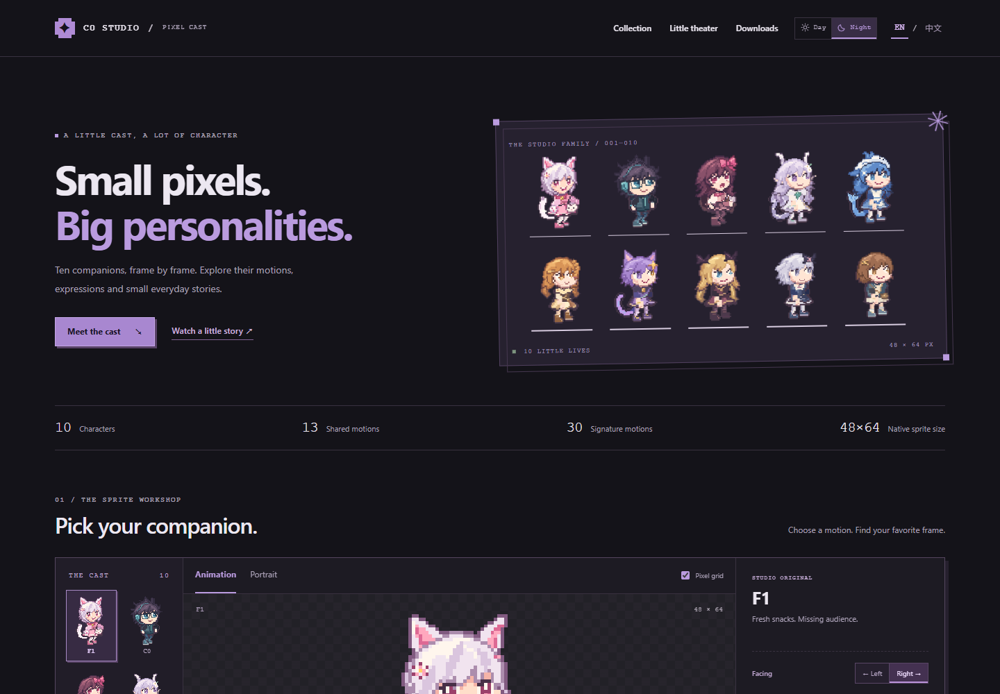
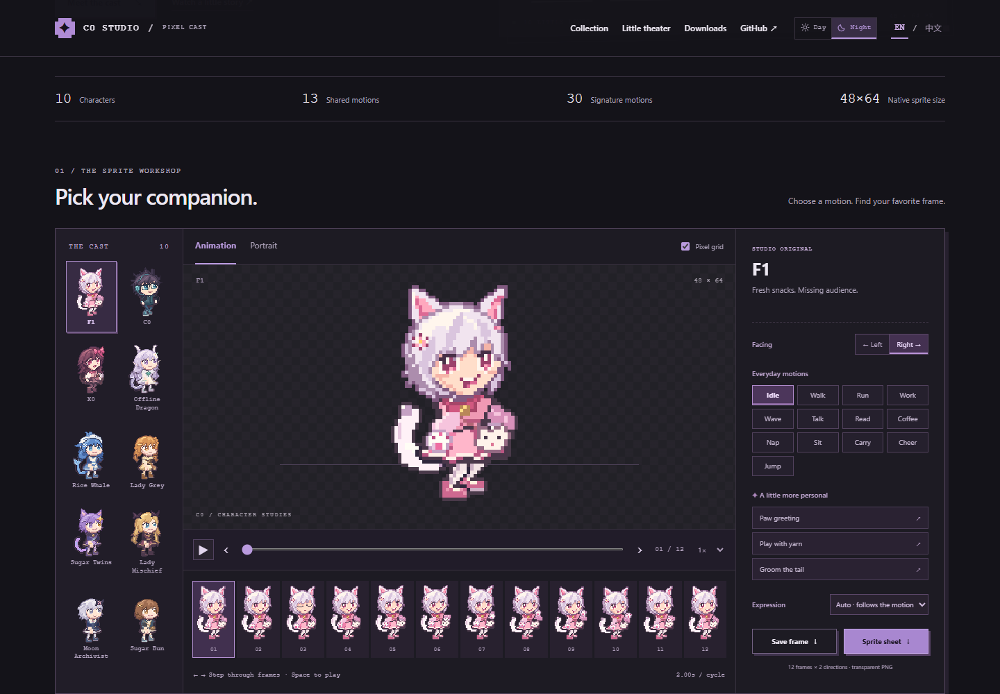

<div align="center">

# C0 Studio Pixel Cast

**Small pixels. Big personalities.**

Ten pixel companions, an animation workshop, and a little theater.

[中文说明](README.zh-CN.md) · [Live gallery](https://c0feline1.github.io/c0-studio-pixel-cast/) · [Download all characters](downloads/all-characters.zip) · [Sprite guide](assets/README.md) · [Credits & licenses](ATTRIBUTION.md)



</div>

## Meet the cast

A collection by **C0 STUDIO**, inspired by the creator's everyday experiences with AI tools. Explore each companion's motions, expressions and small stories, then take the sprites into your own project. Free to use and adapt, including commercially, with attribution under **CC BY 4.0**.

| 10 characters | 160 animation sheets | 3,840 animation frames | 190 PNG assets |
| :---: | :---: | :---: | :---: |
| 48 × 64 px cells | 12 frames × 2 directions | 13 shared + 3 signature motions each | Sprites, expressions, portraits & badges |

The studio trio: **F1 · C0 · X0**. The AI-inspired companions: **Offline Dragon · Rice Whale · Lady Grey · Sugar Twins · Lady Mischief · Moon Archivist · Sugar Bun**.

## Aseprite-ready files

All three asset ZIPs include **40 `.aseprite` files**: an animation document, expression poses, portrait and badge for each character. Open and edit immediately; actions and facing directions are tagged. These contain flattened pixel artwork, not reconstructed drawing layers. See the [Aseprite guide](assets/README.md#open-directly-in-aseprite).

## A gallery you can play with

- Preview animations, switch expressions and facing direction, and inspect individual frames.
- Export a transparent frame, full sprite sheet, portrait or theater scene.
- Watch ten little stories, with English and Chinese captions. The original synthesized voices and melodies are preserved in both languages.
- Switch **EN / 中文** and **Day / Night** in the top-right corner. A fresh visit starts in English and dark mode; your choices are remembered.
- Run locally: no account, API key, build step or external service is required.



## Start here

**Just the assets:** download [all ten characters](downloads/all-characters.zip), [the studio trio](downloads/studio-cast.zip), or [the seven AI-inspired companions](downloads/ai-inspired-cast.zip). Unzip and follow the included sprite guide.

**The complete website and editable source:** use GitHub's **Code → Download ZIP**, extract it, and open `index.html`. Keep the adjacent folders together. Alternatively, serve the repository folder:

```sh
python -m http.server 8000
```

Then visit `http://localhost:8000`. Click **Enable sound** inside the theater to hear the original audio.

## Inside the repository

| Path | Contents |
| --- | --- |
| `index.html`, `gallery.*`, `theme.*` | Responsive gallery and appearance controls |
| `i18n.js`, `stories-en.js` | Interface and English theater text |
| `engine/` | Editable drawing, animation, scene and synthesized audio code |
| `assets/` | Ten character folders, PNG sheets, Godot examples and timing manifest |
| `portraits/` | Portraits displayed in the gallery |
| `downloads/` | Ready-to-use asset archives |
| `licenses/` | Full asset, code and bundled font license texts |
| `tools/package.py` | Rebuild the three asset archives using Python's standard library |

See the [sprite guide](assets/README.md) for frame layout, animation timing and Godot import notes. The collection provides art and a showcase, rather than a complete game controller.

## Created from personal experience

The creator states that the designs, artwork, ideas and stories were created by C0 STUDIO from personal experiences using AI tools. These are imaginative, unofficial companions—not official tool mascots or artwork. Names of third-party tools identify inspiration and do not imply affiliation or endorsement. Read the [creator statement](ATTRIBUTION.md).

## Use them in your project

**Artwork and original story content: [CC BY 4.0](licenses/CC-BY-4.0.txt).** You can use, modify and redistribute them, including in commercial projects. Credit **C0 STUDIO**, include the license link and indicate changes. No payment or donation is required.

```text
Pixel characters by C0 STUDIO — C0 Studio Pixel Cast
Source: https://github.com/C0Feline1/c0-studio-pixel-cast
License: CC BY 4.0 — https://creativecommons.org/licenses/by/4.0/
Changes: unmodified [or describe your changes]
```

**Website and rendering code: [MIT](licenses/MIT.txt).** Keep the copyright and license notice when redistributing the code. The artwork rendered by that code remains CC BY 4.0. Embedded fonts retain their [original licenses](ATTRIBUTION.md#fonts).

## Feedback

Found a broken animation or translation? Open an issue with the character, action, browser and steps to reproduce. Contributions are welcome; please keep native pixel dimensions, motion timing and original voice patterns intact unless the change explicitly concerns them.
