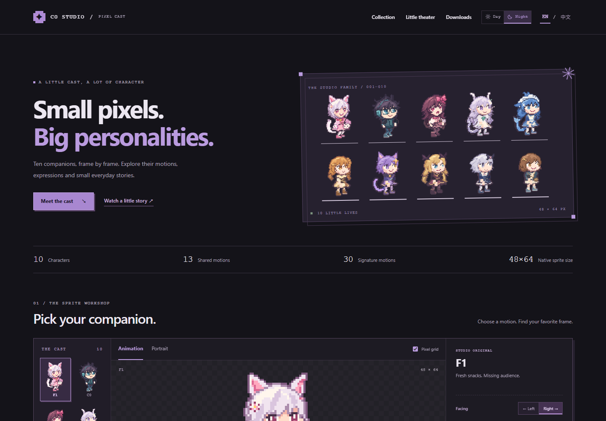
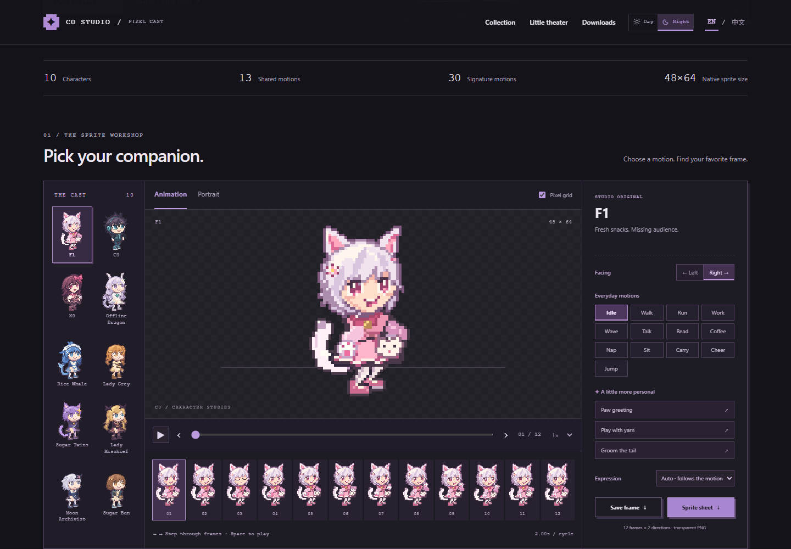

# C0 Studio Pixel Cast · 像素伙伴合集

**像素很小，个性很大。**

[English](README.md) · [下载全部角色](downloads/all-characters.zip) · [素材规格](assets/README.md) · [署名与创作说明](ATTRIBUTION.md)



由 **C0 STUDIO** 创作的十位像素伙伴，附完整网页、动画工作台和小剧场。你可以免费使用、修改和商用素材，按 CC BY 4.0 要求署名即可。

## 包含什么

- 十位角色：F1、C0、X0、断线龙王、干饭鲸、灰号大小姐、糖包双子星、瑟瑟大人、月下资料员、糖包。
- 每位角色 13 个公共动作、3 个专属动作，共 160 张动作图集、3,840 个动作帧。
- 共 190 张 PNG：动作、表情、立绘、徽章；附动画时序 JSON 和 Godot SpriteFrames 示例。
- 十段小剧场，支持中英文文字；保留原有合成音色和旋律。
- 角色预览、逐帧查看、表情和朝向切换、PNG 单帧与图集导出。
- 默认英文和黑夜主题，右上角切换中文/英文、白天/黑夜，并记住选择。

## 怎么使用

只需要素材：下载[十人完整包](downloads/all-characters.zip)、[工作室三人组](downloads/studio-cast.zip)或[七位 AI 灵感伙伴](downloads/ai-inspired-cast.zip)。

想要网页和源码：点击 GitHub 的 **Code → Download ZIP**，解压后打开 `index.html`，保持旁边文件夹完整即可。也可以在仓库目录运行 `python -m http.server 8000`，然后访问 `http://localhost:8000`。无需账号、API 密钥或构建步骤。

每张动作图集为 **576 × 128**，每格 **48 × 64**，每行 12 帧；上排向右，下排向左。帧时长见 `assets/manifest.json` 中的 `frameMs`。放大时使用最近邻采样。立绘和徽章保留各自尺寸。

Godot `.tres` 是导入示例，不包含完整角色控制器；默认循环，请按需要调整一次性动作。原始 ID、时序和中文动作备注保留，元数据添加了 `nameEn` 英文名称。



## 创作说明

作者声明：角色设计、像素绘制、灵感、创意和故事均由 C0 STUDIO 创作，来自自己使用 AI 工具的个人体验。七位 AI 灵感伙伴并非厂商官方角色或官方素材，工具名称仅说明灵感来源，不表示官方关联或认可。

## 免费使用与署名

素材和原创故事采用 **[CC BY 4.0](licenses/CC-BY-4.0.txt)**：允许免费使用、修改、再分发及商用。请署名 **C0 STUDIO**，附许可链接，保留相关声明，并注明修改。无需付款或捐赠。

```text
像素角色：C0 STUDIO — C0 Studio Pixel Cast
来源：https://github.com/C0Feline1/c0-studio-pixel-cast
许可：CC BY 4.0 — https://creativecommons.org/licenses/by/4.0/
修改：未修改（如有修改，请简要说明）
```

网页和绘制程序代码采用 **[MIT](licenses/MIT.txt)**，分发时保留版权及许可文本；代码绘制出的美术仍采用 CC BY 4.0。字体保留[各自原始许可证](ATTRIBUTION.md)。

`tools/package.py` 可用 Python 标准库重新生成三个素材 ZIP。欢迎通过 Issues 反馈角色、动作或翻译问题。
